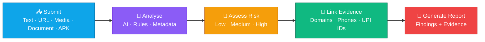
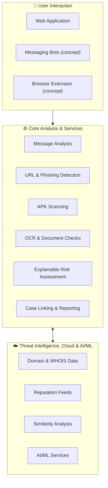
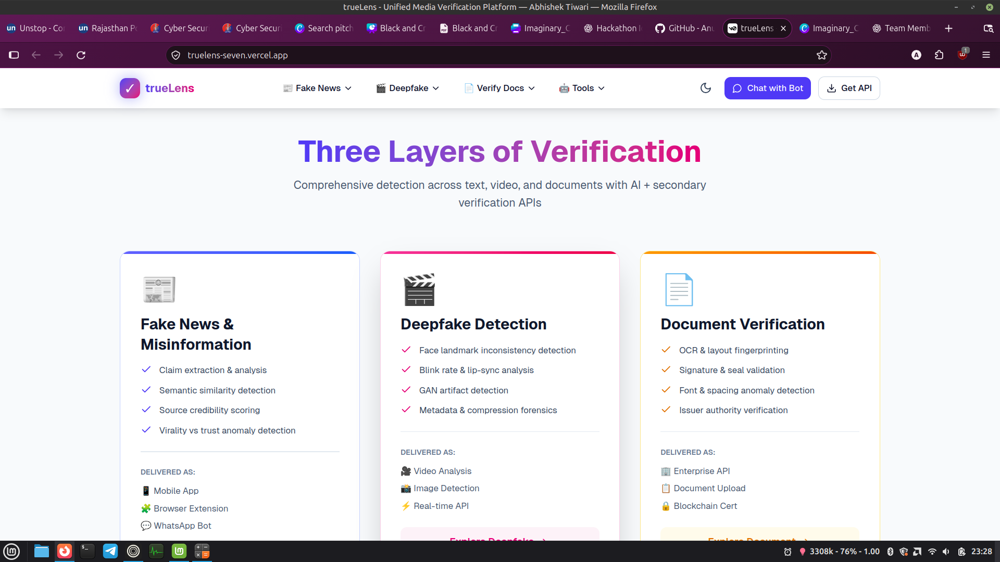
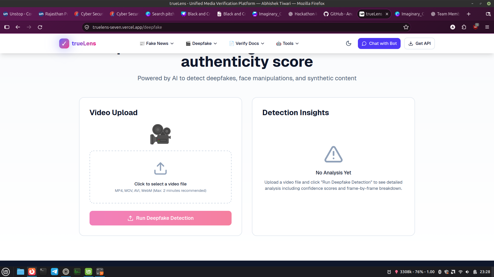

<!-- ═══════════════════════════════════════════════════════════════════════
     trueLens README
     Replace every <your-username>, <repository-url> and "#" link below
     with your real values before publishing.
     ═══════════════════════════════════════════════════════════════════════ -->

<div align="center">


<a href="https://github.com/Anurag-Tiwari">
  
</a>

<br/>

An AI-powered platform for analysing **suspicious messages, phishing links, websites, applications, deepfakes, and documents** — with explainable risk indicators and evidence-oriented reports.

<br/>


<br/>

<!-- Replace "#" with your deployed application URL -->
<a href="#"></a>
&nbsp;
<a href="#-getting-started"></a>
&nbsp;
<a href="#-contributing"></a>

</div>

<br/>

---

## 📚 Table of Contents

| | | |
|---|---|---|
| [🌟 About the Project](#about-the-project) | [⚙️ How It Works](#how-it-works) | [💻 Technology Stack](#technology-stack) |
| [🎯 The Problem](#the-problem) | [🏗️ System Architecture](#system-architecture) | [📂 Project Structure](#project-structure) |
| [🧠 Three-Layer Verification](#three-layer-verification) | [✨ Key Features](#key-features) | [🚀 Getting Started](#getting-started) |
| [🛡️ Verification Capabilities](#verification-capabilities) | [🖥️ Platform Preview](#platform-preview) | [🔑 Environment Variables](#environment-variables) |
| [🗺️ Roadmap](#roadmap) | [🔐 Security & Privacy](#security-privacy) | [⚠️ Limitations & Disclaimer](#limitations-disclaimer) |
| [🤝 Contributing](#contributing) | [📄 License](#license) | |

---

<a id="about-the-project"></a>
## 🌟 About the Project

**trueLens** is a unified digital-content verification platform that helps users examine potentially fraudulent, misleading, or manipulated content through a **single interface**.

Whether it is a suspicious WhatsApp forward, a phishing URL, a potentially fraudulent investment application, a manipulated video, or a forged certificate — trueLens brings multiple verification workflows together in one place.

The platform follows an **AI + rules + secondary verification** approach. Instead of simply labelling content as *real* or *fake*, it makes assessments easier to understand by presenting **risk levels, detected indicators, and supporting evidence**.

> 💡 **Our philosophy:** a verdict you can't understand is a verdict you can't trust. Every result in trueLens comes with the reasons behind it.

<br/>

<a id="the-problem"></a>
## 🎯 The Problem

Digital fraud and misinformation take many forms, and each usually needs a different tool and investigation method:

| Threat | What it looks like |
|:---|:---|
| 📩 **Scam messages** | Distributed through SMS, email, and messaging platforms. |
| 🔗 **Phishing links** | Look-alike websites designed to steal personal or financial information. |
| 📱 **Fraudulent applications** | Fake loans, investments, betting, Ponzi schemes, or MLM schemes. |
| 🎭 **Deepfake media** | Manipulated content that misrepresents people, events, or statements. |
| 📄 **Forged documents** | Certificates, identity documents, signatures, and official records. |

**trueLens brings these checks into one unified verification experience.**

<br/>

<a id="three-layer-verification"></a>
## 🧠 Three-Layer Verification

trueLens is designed around three complementary verification layers:

| Layer | Purpose |
|:---|:---|
| 🧠 **1. Primary AI Detection** | Analyses submitted content using task-specific AI/ML models, pattern detection, and rule-based checks. |
| 🔎 **2. Secondary Verification** | Cross-checks available signals using external verification services, reputation sources, and threat-intelligence feeds where configured. |
| 📊 **3. Confidence Aggregation** | Combines the available results into an explainable risk assessment. |

This layered approach reduces reliance on any single detection signal and provides additional context for human review.

<br/>

<a id="verification-capabilities"></a>
## 🛡️ Verification Capabilities

<details open>
<summary><b>📰 1. Fake News, Scam Messages & Phishing</b></summary>
<br/>

Analyses text and links to identify suspicious claims, scam language, and potentially harmful destinations.

- Extracts claims and relevant indicators from submitted text.
- Analyses SMS, WhatsApp messages, emails, and social-media posts.
- Detects urgency, impersonation, suspicious requests, and common scam patterns.
- Examines URLs, redirects, look-alike domains, HTTPS status, and reputation signals.
- Uses semantic similarity and source-credibility signals to support assessment.
- Flags suspicious websites associated with fake loans, investments, Ponzi schemes, MLM schemes, and betting platforms.

</details>

<details open>
<summary><b>🎭 2. Deepfake Detection</b></summary>
<br/>

Examines uploaded visual media for possible signs of manipulation.

- Facial-landmark inconsistencies.
- Blink-rate irregularities.
- Lip-sync mismatches.
- GAN-related visual artefacts.
- Metadata and compression inconsistencies.

The objective is to provide an **authenticity assessment supported by relevant indicators**, rather than relying only on a binary label.

</details>

<details open>
<summary><b>📄 3. Document Verification</b></summary>
<br/>

Helps inspect certificates, identity documents, and other official records.

- OCR and document-layout analysis.
- Signature and seal validation.
- Font, spacing, and formatting anomaly detection.
- Issuer-authority verification.
- Document-type validation and structured data extraction.

</details>

<details open>
<summary><b>📱 4. App, APK & Website Analysis</b></summary>
<br/>

Examines suspicious applications and websites for potentially harmful characteristics.

- APK permission inspection, including SMS, contacts, camera, and storage access.
- Extraction of embedded URLs, IP addresses, and package metadata.
- Identification of suspicious permissions and application patterns.
- Website, domain, hosting, and identity-level checks.
- Extraction of payment clues, phone numbers, UPI IDs, and related identifiers.

</details>

<br/>

<a id="how-it-works"></a>
## ⚙️ How It Works

A typical verification process follows **five steps**:



| Step | Action | Description |
|:---:|:---|:---|
| **1** | 📤 **Submit** | Enter suspicious text or a URL, or upload supported media, a document, or an application file. |
| **2** | 🤖 **Analyse** | Run the relevant AI, rule-based, metadata, URL, or document checks. |
| **3** | 🚦 **Assess Risk** | Combine available signals into **Low**, **Medium**, or **High** risk levels, with readable explanations. |
| **4** | 🔗 **Link Evidence** | Match related domains, phone numbers, UPI IDs, accounts, and previously observed cases where data is available. |
| **5** | 📝 **Generate Report** | Present findings and supporting evidence in a structured report for review or follow-up. |

<br/>

<a id="system-architecture"></a>
## 🏗️ System Architecture

At a high level, trueLens is organised into three connected areas:



| Component | Responsibilities |
|:---|:---|
| 👤 **User Interaction** | Web application and other access points through which users submit content and review results. |
| ⚙️ **Core Analysis & Services** | Message analysis, URL and phishing detection, APK scanning, website analysis, OCR, explainable risk assessment, case linking, reporting, and evidence handling. |
| ☁️ **Threat Intelligence, Cloud & AI/ML** | Domain and WHOIS data, redirect and HTTPS checks, reputation feeds, app metadata, payment-identifier extraction, similarity analysis, and AI/ML services. |

> 🧩 The modular design allows verification capabilities to be developed and integrated **independently**.

<br/>

<a id="key-features"></a>
## ✨ Key Features

| Feature | Description |
|:---|:---|
| 🔍 **Unified Analysis** | Multiple content types and verification workflows in one platform. |
| 🚨 **Risk Classification** | Low, Medium, and High risk categories with reasons. |
| 🧾 **Explainable Results** | Displays detected indicators to help users understand an assessment. |
| 🔗 **Linked Identifiers** | Connects related domains, phone numbers, UPI IDs, and accounts where data is available. |
| 📑 **Evidence-Oriented Reports** | Organises findings for further review and investigation. |
| 🌐 **Integration Options** | Web interface, messaging bot concepts, browser extension, and API integration options. |
| 🌓 **Theme Support** | Light and dark interface themes. |
| 📱 **Responsive Interface** | Designed for desktop and mobile screen sizes. |

<br/>

<a id="platform-preview"></a>
## 🖥️ Platform Preview

The following screenshots showcase the platform interface and its key sections.

### 🏠 Homepage
The main dashboard introduces the platform's verification areas: fake news, deepfakes, and document verification.

<p align="center">
  
</p>

### 🧩 Three Layers of Verification
A unified view of the platform's three-layer verification approach.

<p align="center">
  
</p>

### 📰 Fake News & Text Analysis
Submit text for claim extraction, source verification, and anomaly analysis.

<p align="center">
  
</p>

### 🎭 Deepfake Detection
Upload a video for deepfake analysis and review the detection insights.

<p align="center">
  
</p>

### 📄 Document Verification
Upload a certificate, ID, or other supported document for verification checks.

<p align="center">
  
</p>

<details>
<summary><b>🔽 See more screens — Enterprise, Blockchain & Integrations</b></summary>
<br/>

### 🏢 Enterprise Solutions
Illustrative use cases across education, HR departments, and finance.

<p align="center">
  
</p>

### ⛓️ Blockchain Certification
A concept for timestamped verification records and verifiable credentials.

<p align="center">
  
</p>

### 💬 Messaging Platform Integrations
Bot interface concepts for WhatsApp and Telegram.

<p align="center">
  
</p>

Additional integration concepts for Discord and Slack.

<p align="center">
  
</p>

</details>

<br/>

<a id="technology-stack"></a>
## 💻 Technology Stack

<div align="center">


</div>

### Frontend

| Technology | Usage |
|:---|:---|
| ⚛️ **React 19** | UI components. |
| ▲ **Next.js 16** | App Router and application framework. |
| 🔷 **TypeScript** | Type-safe development. |
| 🎨 **Tailwind CSS v4** | Styling and responsive layouts. |
| ✨ **Custom CSS** | Animations, transitions, and visual effects. |

### Application Areas

- 📰 Fake news and misinformation analysis
- 🎭 Deepfake detection
- 📄 Document verification
- 💬 Bot and integration pages
- 🔌 API information
- 👥 Community interface

<br/>

<a id="project-structure"></a>
## 📂 Project Structure

The main application pages and reusable UI components are organised as follows:

```text
.
├── app/
│   ├── page.tsx                  # Main landing page
│   ├── layout.tsx                # Root layout and metadata
│   ├── globals.css               # Global styles, themes and animations
│   ├── fake-news/
│   │   └── page.tsx              # Fake news analysis
│   ├── deepfake/
│   │   └── page.tsx              # Deepfake detection
│   ├── documents/
│   │   └── page.tsx              # Document verification
│   ├── bots/
│   │   └── page.tsx              # Messaging platform integrations
│   ├── apis/
│   │   └── page.tsx              # API information
│   └── community/
│       └── page.tsx              # Community interface
│
├── components/
│   ├── navbar.tsx                # Navigation and theme toggle
│   ├── hero.tsx                  # Landing-page hero section
│   ├── features.tsx              # Verification feature cards
│   ├── tools-section.tsx         # Tools and integrations
│   ├── community.tsx             # Community feed component
│   └── footer.tsx                # Footer and links
│
└── public/
    └── S1.png – S9.png           # README preview screenshots
```

<br/>

<a id="getting-started"></a>
## 🚀 Getting Started

Follow these steps to run trueLens locally.

### 📋 Prerequisites

Make sure the following are installed:

- **Node.js** (LTS version recommended)
- **npm** (included with Node.js)

### 1️⃣ Clone the Repository

```bash
git clone <repository-url>
cd <project-directory>
```

### 2️⃣ Install Dependencies

```bash
npm install
```

### 3️⃣ Configure Environment Variables

Create a `.env.local` file in the project root (see [Environment Variables](#environment-variables)).

### 4️⃣ Start the Development Server

```bash
npm run dev
```

Open **[http://localhost:3000](http://localhost:3000)** in your browser. 🎉

### 5️⃣ Create a Production Build

```bash
npm run build
npm start
```

<br/>

<a id="environment-variables"></a>
## 🔑 Environment Variables

Create a `.env.local` file in the root directory:

```env
NEXT_PUBLIC_API_BASE_URL=https://api.truelens.io
NEXT_PUBLIC_DEV_SUPABASE_REDIRECT_URL=http://localhost:3000
```

| Variable | Description |
|:---|:---|
| `NEXT_PUBLIC_API_BASE_URL` | Base URL of the trueLens backend API. |
| `NEXT_PUBLIC_DEV_SUPABASE_REDIRECT_URL` | Redirect URL used for authentication during local development. |

> ⚠️ Set values appropriate to your own deployment. **Never commit private keys, access tokens, or other secrets** to the repository.

<br/>

<a id="roadmap"></a>
## 🗺️ Roadmap

- [x] Unified web interface for fake news, deepfake, and document verification
- [x] Light and dark themes with responsive layout
- [x] Landing page, API information, and community interface
- [ ] Messaging bot integrations — WhatsApp, Telegram, Discord, Slack *(concept)*
- [ ] Browser extension for in-page link and content checks *(concept)*
- [ ] Blockchain-backed timestamped verification records *(concept)*
- [ ] Public API for third-party integration
- [ ] Expanded case linking across domains, phone numbers, and UPI IDs

> Roadmap items marked *(concept)* are design ideas shown in the interface previews and are not yet released features.

<br/>

<a id="security-privacy"></a>
## 🔐 Security & Privacy

trueLens is designed around the following principles:

- 🔒 Encrypted handling of submitted media where supported.
- 🧹 Minimal retention of user-submitted content.
- 👥 Role-based access for organisational workflows.
- 📋 Audit-friendly records for verification activity.
- 🧠 Explainable assessments that expose the reasons behind a result.
- 🛡️ Controlled access to verification APIs and connected services.

> **Note:** Actual protections depend on the deployed backend, storage configuration, and integrations.

<br/>

<a id="contributing"></a>
## 🤝 Contributing

Contributions are what make open source great. Any contribution you make is **greatly appreciated**.

1. 🍴 **Fork** the repository
2. 🌱 Create your feature branch — `git checkout -b feature/amazing-feature`
3. 💾 Commit your changes — `git commit -m "Add amazing feature"`
4. 📤 Push to the branch — `git push origin feature/amazing-feature`
5. 🔃 Open a **Pull Request**

Found a bug or have an idea? Please [open an issue](../../issues) and describe it clearly.

<br/>

<a id="license"></a>
## 📄 License

<!-- Add a LICENSE file to your repository and update the line below -->
Distributed under the license specified in the [`LICENSE`](LICENSE) file. See it for more information.

<br/>

<a id="limitations-disclaimer"></a>
## ⚠️ Limitations & Disclaimer

> **Automated verification is not infallible.** False positives and false negatives are possible.
>
> A risk score is an **indicator based on available signals** — it is **not** a legal, forensic, or official determination.
>
> High-impact decisions should involve **human review** and **independent confirmation** from authoritative sources. The availability and accuracy of individual checks depend on the models, APIs, and threat-intelligence services configured in the running deployment.

<br/>

---

<div align="center">

### 🔍 trueLens
**Making digital verification clearer, more accessible, and evidence-oriented.**

<!-- Replace "#" with your deployed application URL -->
<a href="#"></a>

<sub>If you found this project useful, please consider giving it a ⭐</sub>


</div>
