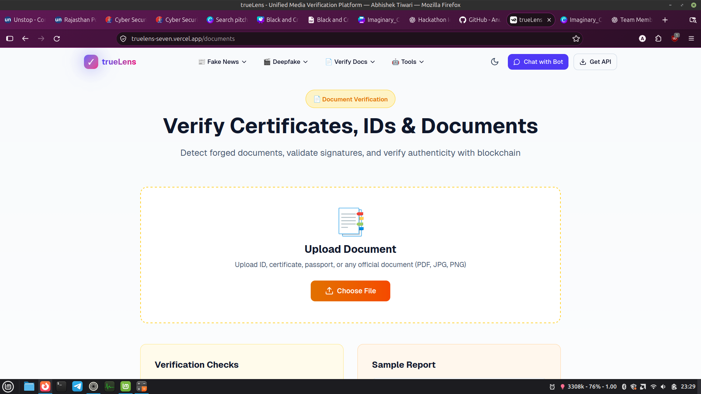
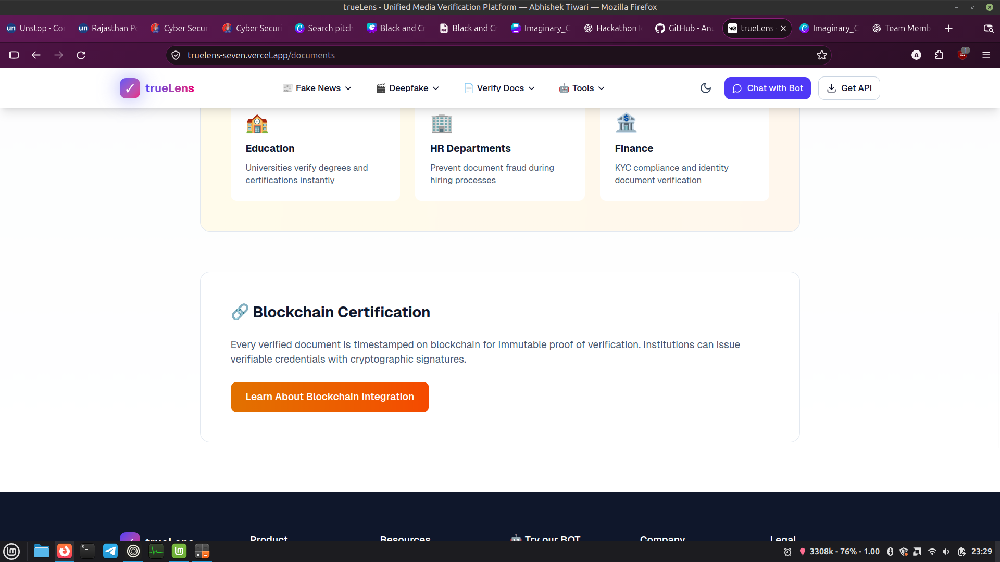
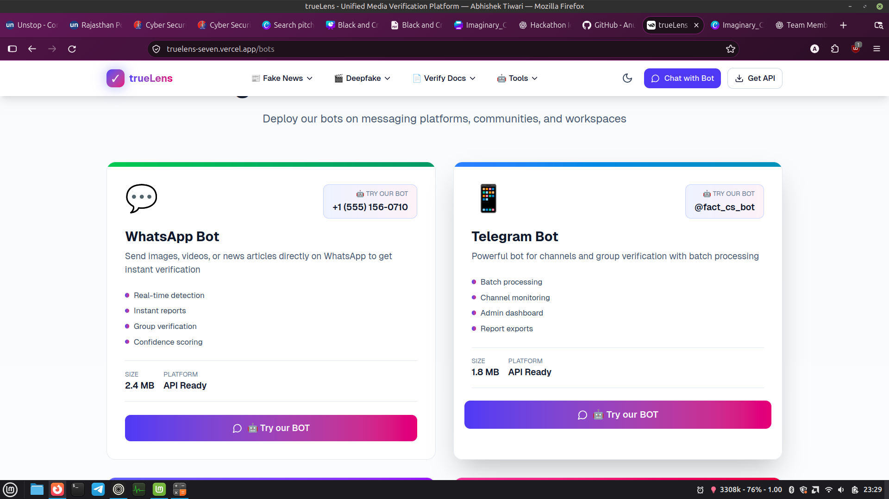
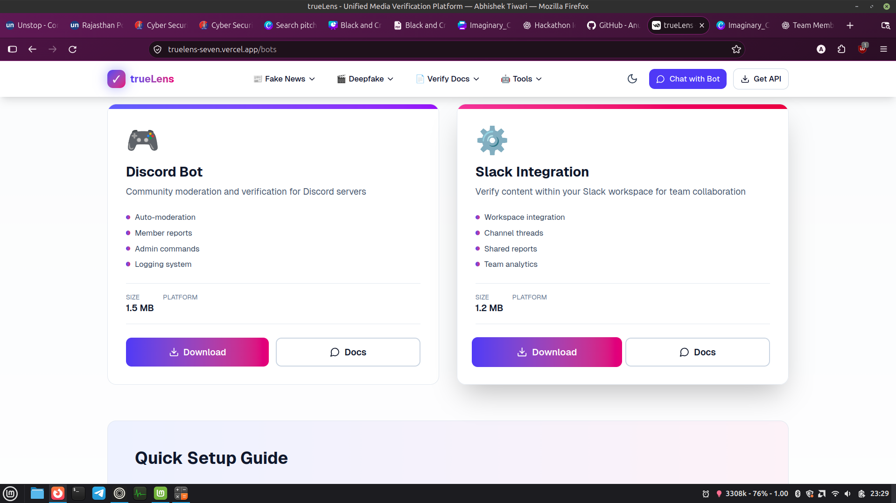

🔍 trueLens
Unified Media Verification Platform
Detect misinformation. Identify digital fraud. Verify media and documents.

An AI-powered platform for analysing suspicious messages, phishing links, websites, applications, deepfakes, and documents — with explainable risk indicators and evidence-oriented reports.

🌐 Live Platform <!-- Replace # with the deployed application URL -->

📑 Table of Contents
- About trueLens
- The Problem
- How Verification Works
- Verification Capabilities
  - Fake News, Scam Messages & Phishing
  - Deepfake Detection
  - Document Verification
  - App, APK & Website Analysis
- Verification Workflow
- System Architecture
- Key Features
- Platform Preview
- Technology Stack
- Project Structure
- Getting Started
- Environment Configuration
- Security & Privacy
- Limitations & Disclaimer
🌟 About trueLens
trueLens is a unified digital-content verification platform that helps users examine potentially fraudulent, misleading, or manipulated content through a single interface.

Whether it is a suspicious WhatsApp forward, a phishing URL, a potentially fraudulent investment application, a manipulated video, or a forged certificate, trueLens brings multiple verification workflows together.

The platform follows an AI + rules + secondary verification approach. Instead of simply labelling content as real or fake, it aims to make assessments easier to understand by presenting risk levels, detected indicators, and supporting evidence.
🎯 The Problem
Digital fraud and misinformation take many forms:
- 📩 Scam messages distributed through SMS, email, and messaging platforms.
- 🔗 Phishing links and look-alike websites designed to steal personal or financial information.
- 📱 Fraudulent applications involving fake loans, investments, betting, Ponzi schemes, or MLM schemes.
- 🎭 Deepfake media that can misrepresent people, events, or statements.
- 📄 Forged documents such as certificates, identity documents, signatures, and official records.
These threats often require separate tools and investigation methods. trueLens aims to bring these checks into one unified verification experience.
🧠 How Verification Works
trueLens is designed around three complementary verification layers:
Layer	Role
🧠 1. Primary AI Detection	Analyses submitted content using task-specific AI/ML models, pattern detection, and rule-based checks.
🔎 2. Secondary Verification	Cross-checks available signals using external verification services, reputation sources, and threat-intelligence feeds where configured.
📊 3. Confidence Aggregation	Combines the available results into an explainable risk assessment.

This layered approach is intended to reduce reliance on any single detection signal and provide additional context for human review.
🛡️ Verification Capabilities
1. 📰 Fake News, Scam Messages & Phishing
Analyses text and links to identify suspicious claims, scam language, and potentially harmful destinations.

Analysis capabilities
- Extracts claims and relevant indicators from submitted text.
- Analyses SMS, WhatsApp messages, emails, and social-media posts.
- Detects urgency, impersonation, suspicious requests, and common scam patterns.
- Examines URLs, redirects, look-alike domains, HTTPS status, and reputation signals.
- Uses semantic similarity and source-credibility signals to support assessment.
- Flags suspicious websites associated with fake loans, investments, Ponzi schemes, MLM schemes, and betting platforms.
2. 🎭 Deepfake Detection
Examines uploaded visual media for possible signs of manipulation.

Detection indicators
- Facial-landmark inconsistencies.
- Blink-rate irregularities.
- Lip-sync mismatches.
- GAN-related visual artefacts.
- Metadata and compression inconsistencies.
The objective is to provide an authenticity assessment supported by relevant indicators, rather than relying only on a binary label.
3. 📄 Document Verification
Helps inspect certificates, identity documents, and other official records.

Verification checks
- OCR and document-layout analysis.
- Signature and seal validation.
- Font, spacing, and formatting anomaly detection.
- Issuer-authority verification.
- Document-type validation and structured data extraction.
4. 📱 App, APK & Website Analysis
Examines suspicious applications and websites for potentially harmful characteristics.

Analysis capabilities
- APK permission inspection, including SMS, contacts, camera, and storage access.
- Extraction of embedded URLs, IP addresses, and package metadata.
- Identification of suspicious permissions and application patterns.
- Website, domain, hosting, and identity-level checks.
- Extraction of payment clues, phone numbers, UPI IDs, and related identifiers.
⚙️ Verification Workflow
A typical verification process follows five steps:
1. 📤 Submit — Enter suspicious text or a URL, or upload supported media, a document, or an application file.
2. 🤖 Analyse — Run the relevant AI, rule-based, metadata, URL, or document checks.
3. 🚦 Assess Risk — Combine available signals into Low, Medium, or High risk levels, with readable explanations.
4. 🔗 Link Evidence — Match related domains, phone numbers, UPI IDs, accounts, and previously observed cases where data is available.
5. 📝 Generate Report — Present findings and supporting evidence in a structured report for review or follow-up.
🏗️ System Architecture
At a high level, trueLens is organised into three connected areas:
Component	Responsibilities
👤 User Interaction	Web application and other access points through which users submit content and review results.
⚙️ Core Analysis & Services	Message analysis, URL and phishing detection, APK scanning, website analysis, OCR, explainable risk assessment, case linking, reporting, and evidence handling.
☁️ Threat Intelligence, Cloud & AI/ML	Domain and WHOIS data, redirect and HTTPS checks, reputation feeds, app metadata, payment-identifier extraction, similarity analysis, and AI/ML services.

The modular design allows verification capabilities to be developed and integrated independently.
✨ Key Features
Feature	Description
🔍 Unified Analysis	Multiple content types and verification workflows in one platform.
🚨 Risk Classification	Low, Medium, and High risk categories with reasons.
🧾 Explainable Results	Displays detected indicators to help users understand an assessment.
🔗 Linked Identifiers	Connects related domains, phone numbers, UPI IDs, and accounts where data is available.
📑 Evidence-Oriented Reports	Organises findings for further review and investigation.
🌐 Integration Options	Web interface, messaging bot concepts, browser extension, and API integration options.
🌓 Theme Support	Light and dark interface themes.
📱 Responsive Interface	Designed for desktop and mobile screen sizes.

🖥️ Platform Preview
The following screenshots showcase the platform interface and its key sections.
🏠 Homepage
The main dashboard introduces the platform's verification areas: fake news, deepfakes, and document verification.

  

🧩 Three Layers of Verification
A unified view of the platform's three-layer verification approach.

  

📰 Fake News & Text Analysis
Submit text for claim extraction, source verification, and anomaly analysis.

  

🎭 Deepfake Detection
Upload a video for deepfake analysis and review the detection insights.

  

📄 Document Verification
Upload a certificate, ID, or other supported document for verification checks.

  

🏢 Enterprise Solutions
Illustrative use cases across education, HR departments, and finance.

  

⛓️ Blockchain Certification
A concept for timestamped verification records and verifiable credentials.

  

💬 Messaging Platform Integrations
Bot interface concepts for WhatsApp and Telegram.

  

Additional integration concepts for Discord and Slack.

  

💻 Technology Stack
Frontend
- ⚛️ React 19 — UI components.
- ▲ Next.js 16 — App Router and application framework.
- 🔷 TypeScript — Type-safe development.
- 🎨 Tailwind CSS v4 — Styling and responsive layouts.
- ✨ Custom CSS — Animations, transitions, and visual effects.
Application Areas
- Fake news and misinformation analysis.
- Deepfake detection.
- Document verification.
- Bot and integration pages.
- API information.
- Community interface.
📂 Project Structure
The main application pages and reusable UI components are organised as follows:
.
├── app/
│   ├── page.tsx                  # Main landing page
│   ├── layout.tsx                # Root layout and metadata
│   ├── globals.css               # Global styles, themes and animations
│   ├── fake-news/
│   │   └── page.tsx              # Fake news analysis
│   ├── deepfake/
│   │   └── page.tsx              # Deepfake detection
│   ├── documents/
│   │   └── page.tsx              # Document verification
│   ├── bots/
│   │   └── page.tsx              # Messaging platform integrations
│   ├── apis/
│   │   └── page.tsx              # API information
│   └── community/
│       └── page.tsx              # Community interface
│
├── components/
│   ├── navbar.tsx                # Navigation and theme toggle
│   ├── hero.tsx                  # Landing-page hero section
│   ├── features.tsx              # Verification feature cards
│   ├── tools-section.tsx         # Tools and integrations
│   ├── community.tsx             # Community feed component
│   └── footer.tsx                # Footer and links
│
└── public/
    └── S1.png – S9.png           # README preview screenshots
🚀 Getting Started
Follow these steps to run trueLens locally.
Prerequisites
Make sure the following are installed:
- Node.js (LTS version recommended)
- npm (included with Node.js)
1. Clone the Repository
git clone <repository-url>
cd <project-directory>
2. Install Dependencies
npm install
3. Start the Development Server
npm run dev
Open http://localhost:3000 in your browser.
4. Create a Production Build
npm run build
npm start
🔑 Environment Configuration
The project configuration notes include the following example environment variables:
NEXT_PUBLIC_API_BASE_URL=https://api.truelens.io
NEXT_PUBLIC_DEV_SUPABASE_REDIRECT_URL=http://localhost:3000
Set values appropriate to your own deployment. Never commit private keys, access tokens, or other secrets to the repository.
🔐 Security & Privacy
trueLens is designed around the following principles:
- 🔒 Encrypted handling of submitted media where supported.
- 🧹 Minimal retention of user-submitted content.
- 👥 Role-based access for organisational workflows.
- 📋 Audit-friendly records for verification activity.
- 🧠 Explainable assessments that expose the reasons behind a result.
- 🛡️ Controlled access to verification APIs and connected services.
Actual protections depend on the deployed backend, storage configuration, and integrations.

🔍 trueLens
Making digital verification clearer, more accessible, and evidence-oriented.

🌐 Visit trueLens <!-- Replace # with the deployed application URL -->

