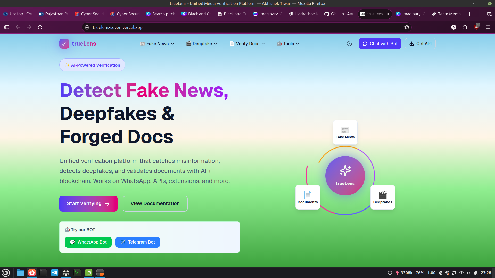
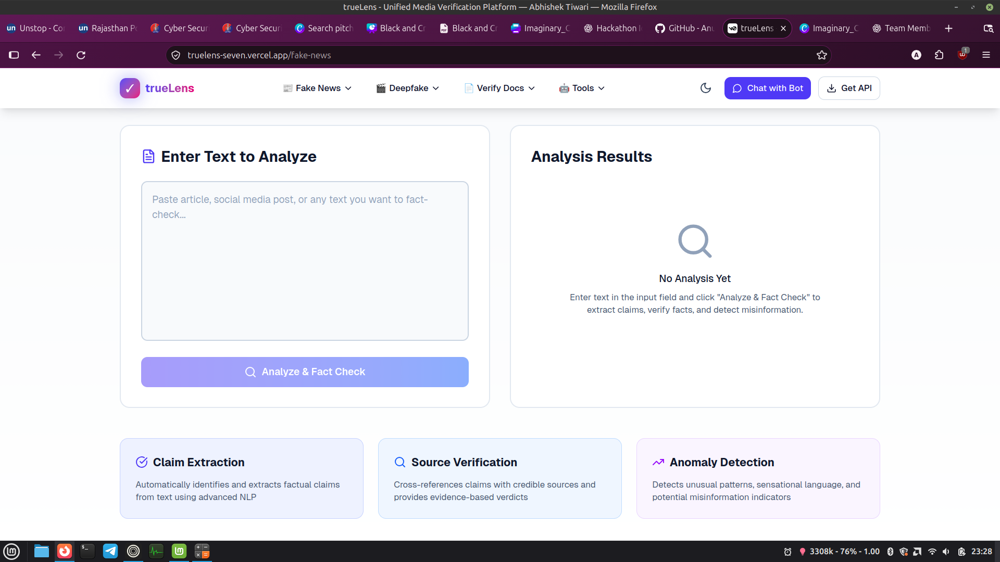
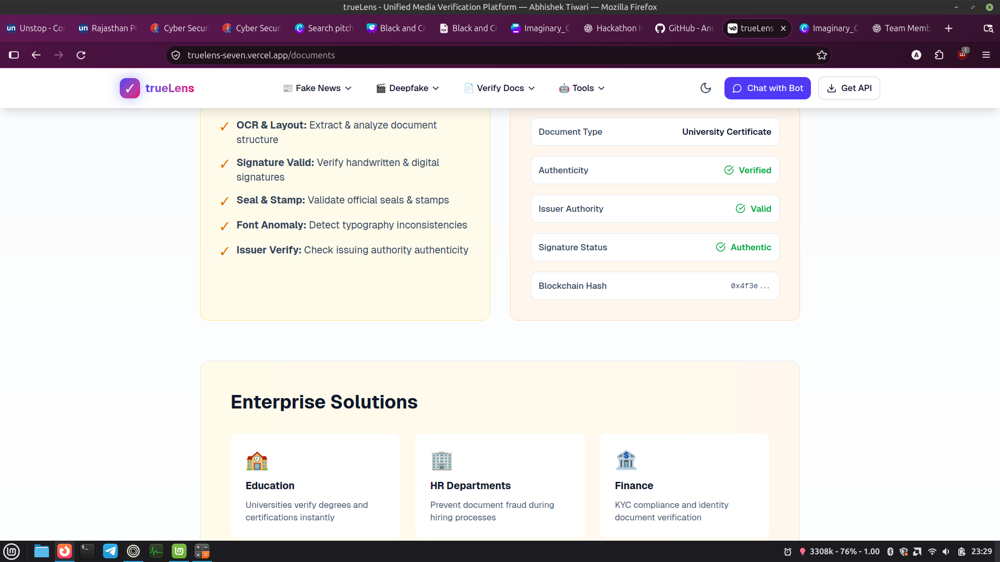

🔍 trueLens
Unified Media Verification Platform

Detect misinformation. Identify digital fraud. Verify media and documents.

A unified, AI-powered platform designed to analyse suspicious messages, phishing links, websites, applications, deepfakes, and documents — with explainable risk indicators and evidence-oriented reports.

🌐 Live Platform: trueLens

📑 Table of Contents

    🌟 Overview
    🎯 The Problem
    🧠 Three-Layer Verification
    🛡️ What trueLens Verifies
        Fake News, Scam Messages & Phishing
        Deepfake Detection
        Document Verification
        App, APK & Website Analysis
    ⚙️ How It Works
    🏗️ System Architecture
    ✨ Key Features
    🖥️ Platform Preview
    💻 Technology Stack
    📂 Project Structure
    🚀 Getting Started
    🔐 Security & Privacy
    ⚠️ Important Notes

🌟 Overview

trueLens is a unified digital-content verification platform that helps users examine potentially fraudulent or manipulated content from a single interface.

From a suspicious WhatsApp forward or phishing URL to a fake investment application, manipulated video, or forged certificate, trueLens brings multiple analysis workflows together.

The platform follows an AI + rules + secondary verification approach. It aims to make results easier to interpret by showing risk levels, detected indicators, and supporting evidence — rather than simply labelling content as real or fake.
🎯 The Problem

Digital fraud and misinformation appear in many forms:

    📩 Scam messages delivered through SMS, email, and messaging apps.
    🔗 Phishing links and look-alike websites designed to steal information.
    📱 Fake loan, investment, betting, Ponzi, and MLM applications.
    🎭 Deepfake images and videos that can misrepresent people or events.
    📄 Forged certificates, identity documents, signatures, and official records.

These threats often require different tools to investigate. trueLens aims to bring these checks into one unified verification experience.
🧠 Three-Layer Verification

The platform is designed around three complementary layers:
Layer	Purpose
🧠 1. Primary AI Detection	Analyses submitted content using task-specific AI/ML models, pattern detection, and rule-based checks.
🔎 2. Secondary Verification	Cross-checks available signals using external verification services, reputation sources, and threat-intelligence feeds where configured.
📊 3. Confidence Aggregation	Combines the available results into an explainable risk assessment.

This layered approach is intended to reduce reliance on a single detection signal and provide more context for human review.
🛡️ What trueLens Verifies
1. 📰 Fake News, Scam Messages & Phishing

Analyses text and links to identify suspicious claims, scam language, and potentially harmful destinations.

Analysis capabilities:

    Extracts claims and relevant indicators from submitted text.
    Analyses SMS, WhatsApp messages, emails, and social-media posts.
    Detects urgency, impersonation, suspicious requests, and common scam patterns.
    Examines URLs, redirects, look-alike domains, HTTPS status, and reputation signals.
    Uses semantic similarity and source-credibility signals to support assessment.
    Flags suspicious websites associated with fake loans, investments, Ponzi schemes, MLM, and betting platforms.

2. 🎭 Deepfake Detection

Examines uploaded visual media for possible signs of manipulation.

Detection indicators:

    Facial-landmark inconsistencies.
    Blink-rate irregularities.
    Lip-sync mismatches.
    GAN-related visual artefacts.
    Metadata and compression inconsistencies.

The objective is to provide an authenticity assessment with relevant indicators, not just a binary label.
3. 📄 Document Verification

Helps inspect certificates, identity documents, and other official records.

Verification checks:

    OCR and document-layout analysis.
    Signature and seal validation.
    Font, spacing, and formatting anomaly detection.
    Issuer-authority verification.
    Document-type validation and structured data extraction.

4. 📱 App, APK & Website Analysis

Examines suspicious applications and websites for potentially harmful characteristics.

Analysis capabilities:

    APK permission inspection, including SMS, contacts, camera, and storage access.
    Extraction of embedded URLs, IP addresses, and package metadata.
    Identification of suspicious permissions and app patterns.
    Website, domain, hosting, and identity-level checks.
    Extraction of payment clues, phone numbers, UPI IDs, and related identifiers.

⚙️ How It Works

The typical verification flow consists of five steps:
<ol> <li><strong>📤 Submit:</strong> Enter suspicious text or a URL, or upload supported media, a document, or an application file.</li> <li><strong>🤖 Analyse:</strong> Run relevant AI, rule-based, metadata, URL, or document checks.</li> <li><strong>🚦 Assess Risk:</strong> Combine available signals into Low, Medium, or High risk levels, with readable explanations.</li> <li><strong>🔗 Link Evidence:</strong> Match related domains, phone numbers, UPI IDs, accounts, and previously observed cases where data is available.</li> <li><strong>📝 Report:</strong> Present findings and supporting evidence in a structured report for review or follow-up.</li> </ol>
🏗️ System Architecture

At a high level, trueLens is organised into three connected areas:

    👤 User Interaction: Web application and other access points through which users submit content and review results.
    ⚙️ Core Analysis & Services: Message analysis, URL and phishing detection, APK scanning, website analysis, OCR, explainable risk assessment, case linking, reporting, and evidence handling.
    ☁️ Threat Intelligence, Cloud & AI/ML: Domain and WHOIS data, redirect and HTTPS checks, reputation feeds, app metadata, payment-identifier extraction, similarity analysis, and AI/ML services.

The modular design allows verification capabilities to be developed and integrated independently.
✨ Key Features
Feature	Description
🔍 All-in-One Analysis	Multiple content types and verification workflows in one platform.
🚨 Risk Classification	Low, Medium, and High risk categories with reasons.
🧾 Explainable Results	Shows detected indicators to help users understand an assessment.
🔗 Linked Identifiers	Connects related domains, phone numbers, UPI IDs, and accounts where data is available.
📑 Evidence-Oriented Reports	Organises findings for further review and investigation.
🌐 Multi-Platform Access	Web interface, messaging bot concepts, browser extension, and API integration options.
🌓 Theme Support	Light and dark interface themes.
📱 Responsive UI	Designed to work across desktop and mobile screen sizes.
🖥️ Platform Preview
🏠 Homepage

The main dashboard introduces the three verification areas: fake news, deepfakes, and document verification.

  

🧩 Three Layers of Verification

A unified view of the platform's verification capabilities.

  

📰 Fake News & Text Analysis

Submit text for claim extraction, source verification, and anomaly analysis.

  

🎭 Deepfake Detection

Upload a video for deepfake analysis and review the detection insights.

  

📄 Document Verification

Upload a certificate, ID, or other supported document for verification checks.

  

🏢 Enterprise Solutions

Illustrative use cases across education, HR departments, and finance.

  

⛓️ Blockchain Certification

A concept for timestamped verification records and verifiable credentials.

  

💬 Messaging Platform Integrations

Bot interfaces for WhatsApp and Telegram.

  

Additional integrations for Discord and Slack.

  

💻 Technology Stack
Frontend

    ⚛️ React 19 — UI components.
    ▲ Next.js 16 — App Router and application framework.
    🔷 TypeScript — Type-safe development.
    🎨 Tailwind CSS v4 — Styling and responsive layouts.
    ✨ Custom CSS — Animations, transitions, and visual effects.

Application Areas

    Fake news and misinformation analysis.
    Deepfake detection.
    Document verification.
    Bot and integration pages.
    API information.
    Community interface.

📂 Project Structure

The main application pages and reusable UI components are organised as follows:
app/
├── page.tsx                  # Main landing page
├── layout.tsx                # Root layout and metadata
├── globals.css               # Global styles, themes and animations
├── fake-news/
│   └── page.tsx              # Fake news analysis
├── deepfake/
│   └── page.tsx              # Deepfake detection
├── documents/
│   └── page.tsx              # Document verification
├── bots/
│   └── page.tsx              # Messaging platform integrations
├── apis/
│   └── page.tsx              # API information
└── community/
    └── page.tsx              # Community interface

components/
├── navbar.tsx                # Navigation and theme toggle
├── hero.tsx                  # Landing-page hero section
├── features.tsx              # Verification feature cards
├── tools-section.tsx         # Tools and integrations
├── community.tsx             # Community feed component
└── footer.tsx                # Footer and links

assets/                       # README screenshots
🚀 Getting Started
Prerequisites

Make sure you have the following installed:

    Node.js (LTS recommended)
    npm

1. Clone the Repository
git clone <repository-url>
cd <project-directory>
2. Install Dependencies
npm install
3. Start the Development Server
npm run dev

Open http://localhost:3000 in your browser.
4. Create a Production Build
npm run build
npm start
🔑 Environment Variables

The project configuration notes include these example variables:
NEXT_PUBLIC_API_BASE_URL=https://api.truelens.io
NEXT_PUBLIC_DEV_SUPABASE_REDIRECT_URL=http://localhost:3000

Set values appropriate to your own deployment. Never commit private keys, access tokens, or other secrets to the repository.
🔐 Security & Privacy

trueLens is designed with the following principles in mind:

    🔒 Encrypted handling of submitted media where supported.
    🧹 Minimal retention of user-submitted content.
    👥 Role-based access for organisational workflows.
    📋 Audit-friendly records for verification activity.
    🧠 Explainable assessments that expose the reasons behind a result.
    🛡️ Controlled access to verification APIs and connected services.

Actual protections depend on the deployed backend, storage configuration, and integrations.
⚠️ Important Notes

Automated verification is not infallible. False positives and false negatives are possible, and a risk score is an indicator based on available signals — not a legal, forensic, or official determination.

High-impact decisions should involve human review and independent confirmation from authoritative sources. The availability and accuracy of individual checks depend on the models, APIs, and threat-intelligence services configured in the running deployment.

🔍 trueLens

Making digital verification clearer, more accessible, and evidence-oriented.

🌐 Visit trueLens

 
